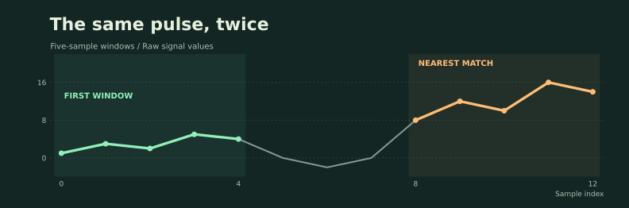

# FlashMP

**Find a shape that repeats in a time series, even when its level and amplitude change.**

FlashMP takes a sequence of numbers and a window length. For each window, its matrix profile gives the distance to the closest matching shape and the sample index where that match begins. A small distance identifies a recurring pattern (a *motif*). A large distance flags a window worth inspecting (a *discord*).

Use it after collecting sensor readings or service metrics, before sending findings to a dashboard, an alert rule, or an agent. The Python package runs its C++20 engine on your CPU. A CLI reads files and a local Model Context Protocol (MCP) server exposes the same analyses to agents.



[Run the example in Colab](https://colab.research.google.com/github/pgg898200-ship-it/flashmp/blob/main/examples/find_a_repeated_shape.ipynb) · [Read the notebook on GitHub](examples/find_a_repeated_shape.ipynb) · [Reproduce the benchmarks](benchmarks/RESULTS.md)

## Find the second occurrence

Install from the tested Git revision in a Python 3.10+ environment with Git and a C++20 compiler (g++ or clang++). The first analysis builds and caches the native library. No Python runtime dependencies are required.

```bash
python -m pip install "git+https://github.com/pgg898200-ship-it/flashmp.git@fb233c569e1cc2b5a4f16c4a486d3f9db6e38807"
```

```python
import flashmp

signal = [1, 3, 2, 5, 4, 0, -2, 0, 8, 12, 10, 16, 14]
profile = flashmp.stump(signal, m=5)

match = int(profile.I_[0])
print(match, signal[match:match + 5])
print(f"{profile.P_[0]:.6f}")
```

```text
8 [8, 12, 10, 16, 14]
0.000000
```

The second window equals twice the first plus six. FlashMP standardizes each window before comparing it, so the two shapes have zero distance to the displayed precision. The index and distance arrays use zero-based window start positions.

## Choose an entry point

| If you have | Use | What you get |
|---|---|---|
| A numeric series and a pattern length | `stump(values, m)` | Nearest-neighbor distances and positions for each window |
| Live samples and a fixed retention window | `StreamMP(m=…, window=…, egress=True)` | A profile over retained samples as old observations expire |
| Training and evaluation series | `scan_leakage(train, test, m=…)` | Candidate overlapping windows, including scaled or sign-flipped matches |
| A CSV and an agent that can call tools | MCP `ts_digest`, then `ts_drilldown` | A summary and a session handle for fetching exact samples by index |

## Verified Benchmarks (`2026-11-22`, 2-vCPU x86-64 AVX2+FMA)

| Workload | **FlashMP `0.1.0`** | `pyscamp` (fp64) | `STUMPY 1.14.1` | Speedup / Edge |
|---|---:|---:|---:|---|
| Cold `import` only | **`0.78 ms`** | — | — | **0 required deps** (no NumPy/Numba) |
| Cold import + first `N=4,096` join | **`42.5 ms`** | `33.2 ms` | `41,906.1 ms` | **`987×`** vs STUMPY |
| Batch Self-Join (`N=32,768, m=64, 2T`) | **`119.5 ms`** | `743.5 ms` | `2,199.6 ms` | **`6.2×`** vs pyscamp · **`18.4×`** vs STUMPY (`3.7e-12` err) |
| Bidirectional AB-Join (`32,768 × 4,096`) | **`37.3 ms`** *(2-way)* | `101.4 ms` *(1-way)* | `481.2 ms` *(1-way)* | **`2.7×`** vs pyscamp · **`12.9×`** vs STUMPY |
| Multivariate `mSTUMP` (`D=8, N=8,192`) | **`248.5 ms`** | Unsupported | `12,079.4 ms` | **`48.6×`** vs STUMPY (`1.2e-10` err) |
| Streaming `W=1,024` (`egress=True`) | **`3.14 µs`** *(full)* / **`1.54 µs`** *(causal)* | Unsupported | `519.9 µs` | **`166×–338×`** (`66.9×` in Python `for` loop) |
| Streaming Egress Parity (`W=1,024..16,384`) | **`2.2e-13`–`1.7e-12`** | Unsupported | **`1.02`–`1.57`** *(stale)* | **Exact** sliding-window MP every tick |
| High-DC Stability (`DC=1e10`, `N=2,048`) | **`4.65e-6`** max err | `2.51e-4` | `2.19e-3` | **`54×`** vs pyscamp · **`471×`** vs STUMPY |
| Post-`1e10`-Spike Exact Motif (True = `0`) | **`2.03e-16`** | **`NaN`** | `0.0` | Immune to transient giant spikes |
| Regime Segmentation (`N=4,000` vs `ruptures`) | **`4.45 ms`** (`24`-tick err) | Unsupported | — | **`9,305×`** vs `ruptures` PELT `rbf` (`41.4 s`) |
| Agentic Context Digest (`N=10,000`) | **`129 tok`** (`33.6 ms`) | — | — | **`-99.31%`** tokens · **`100%`** recall vs **`0%`** LTTB/M4 |
| Multi-Agent `SwarmMonitor` (`1,024` ch) | **`103,740 ch-ticks/s`** | — | — | **`100%`** fault recall · **`0`** loud-distractor FPs · **`119 tok`** |

Full receipts, matched Python-loop streaming timings, and reproduction commands: **[benchmarks/RESULTS.md](benchmarks/RESULTS.md)**.  
Head-to-head guides: **[FlashMP vs STUMPY](docs/vs-stumpy.md)** · **[FlashMP vs pyscamp](docs/vs-pyscamp.md)** · **[Architecture & Proofs](docs/architecture.md)**.

---

## Python and command-line examples

### Batch and multivariate profiles

```python
import flashmp as stumpy

mp = stumpy.stump(x, m=64)            # Drop-in [P, I, left_I, right_I], shape (n, 4)
P, I = stumpy.mstump(X_multivar, 64)  # 48.6x faster multivariate mSTUMP, shape (D, n)
stream = stumpy.stumpi(warmup, m=64, egress=True)
stream.update(new_value)              # Exact bounded-window egress (no stale neighbors)
```

### Bounded-window streaming

```python
import flashmp

with flashmp.StreamMP(m=64, window=4096, egress=True, alpha=0.01) as stream:
    stream.init(warmup_data)
    tick = stream.update(new_value)
    if tick.is_alert:
        print(f"Shape anomaly at gid={tick.gid}: E={tick.e_value:.1f}, z={tick.discord_z:.2f}")
```

### Summarize a series and inspect its raw samples

```python
import flashmp

d = flashmp.digest(x, m=64)           # Compresses 10,000 floats (~18,751 tok) -> ~129 tokens
print(d.to_compact())                 # Feed into any LLM prompt or agent memory

# Losslessly inspect exact bit-identical raw floats whenever the agent wants to zoom in:
anom = d.drilldown_discord(0)
exact_slice = d.drilldown(start=2200, end=2264)
```

### Scan training and evaluation splits

Catches verbatim copies, affine-rescaled/shifted ($a x + b$) windows, and sign-flipped overlaps between training corpora and evaluation splits:

```python
import flashmp

report = flashmp.scan_leakage(train_series, test_series, m=64, corr_thresh=0.999)
print(report.summary())
```

### Monitor multiple channels

Monitor 64–4,096 concurrent streams with scale-invariant causal `RingMP` (immune to $3.5\times$ high-amplitude normal-shape distractors), order-invariant CRDT alert fusion (`AlertLedger`), and strict token-capped briefs:

```python
import flashmp

with flashmp.SwarmMonitor(channel_names, m=32, window=256, alpha=0.05) as mon:
    mon.init_channel("node_0", warmup_0)
    mon.update_frame(live_tick_dict)
    print(mon.brief(max_tokens=300))   # Strictly <= 300 tokens, ranked by E-value
```

### CLI and MCP server

```bash
# Compress any CSV/TSV/JSON/JSONL/txt (or stdin '-') into a ~130-token digest
flashmp digest metrics.csv --col latency_ms --format compact

# Audit train/test CSVs for verbatim & affine subsequence leakage
flashmp leak-scan train.csv test.csv -m 64 --thresh 0.999

# Stream live telemetry from stdin with Ville E-value alerts
tail -f sensor.txt | flashmp watch -m 64 -w 4096 --alpha 0.01 --json

# Launch sandboxed zero-dependency stdio JSON-RPC 2.0 MCP server
flashmp-mcp
```

For clients that use JSON `mcpServers` configuration, point the command at the installed executable. Set the data directory to the location of your files.

```json
{
  "mcpServers": {
    "flashmp": {
      "command": "flashmp-mcp",
      "env": {
        "FLASHMP_MCP_ALLOWED_DIRS": "/path/to/your/data"
      }
    }
  }
}
```

Use `ts_digest` with `values` or a file `path`. Pass the returned `handle`, `start` and exclusive `end` to `ts_drilldown` in that server session to recover a raw interval.

MCP exposes eight tools, `ts_digest`, `ts_drilldown`, `ts_anomalies`, `ts_regimes`, `ts_leak_scan`, `ts_stream_create`, `ts_stream_push`, and `ts_swarm_sift` — with strict `allowed_dirs` path/symlink confinement, bounded 64-session LRU cleanup, and DoS caps.

---

## Scope and limitations

- **Massive single-series batch joins ($N > 10^6$) on an NVIDIA GPU:** Use **[pyscamp](https://github.com/zpzim/SCAMP)** with CUDA GPU acceleration. FlashMP currently targets CPU SIMD (AVX2+FMA / ARM64-NEON) and does not yet include a CUDA backend.
- **Distributed multi-node Dask clusters or specialized niche MP routines:** Use **[STUMPY](https://github.com/TDAmeritrade/stumpy)** if you specifically rely on `stumped` (Dask), `ostinato` (consensus motifs), `mpdist`, or `pan` matrix profiles not yet implemented in FlashMP.
- **Flat subsequences:** In univariate `stump`/`abjoin`/`scan_leakage`, zero-variance (constant) subsequences have undefined z-normalization ($0/0$) and are masked to `+inf` (`idx = -1`) to prevent false zero-distance motifs or leakage hits on flat telemetry (whereas `STUMPY` reports distance `0.0` between flat windows). In `mstump`, FlashMP matches `stumpy.mstump`'s exact flat-window convention.

---

## Documentation & Verification

- **[benchmarks/RESULTS.md](benchmarks/RESULTS.md)** — Full live-measured benchmark suite & reproduction scripts
- **[docs/vs-stumpy.md](docs/vs-stumpy.md)** — Head-to-head comparison with STUMPY
- **[docs/vs-pyscamp.md](docs/vs-pyscamp.md)** — Head-to-head comparison with pyscamp / SCAMP
- **[docs/architecture.md](docs/architecture.md)** — Mathematical proofs & SIMD microarchitecture
- **[SKILL.md](SKILL.md)** & **[llms.txt](llms.txt)** — Agent skill playbook & LLM-readable index

Run the full verification suite (including C++20 AddressSanitizer + UndefinedBehaviorSanitizer stress harness and Red-Team regression tests):

```bash
pytest tests/ -v
```

## License

Apache-2.0 — see [LICENSE](LICENSE).
